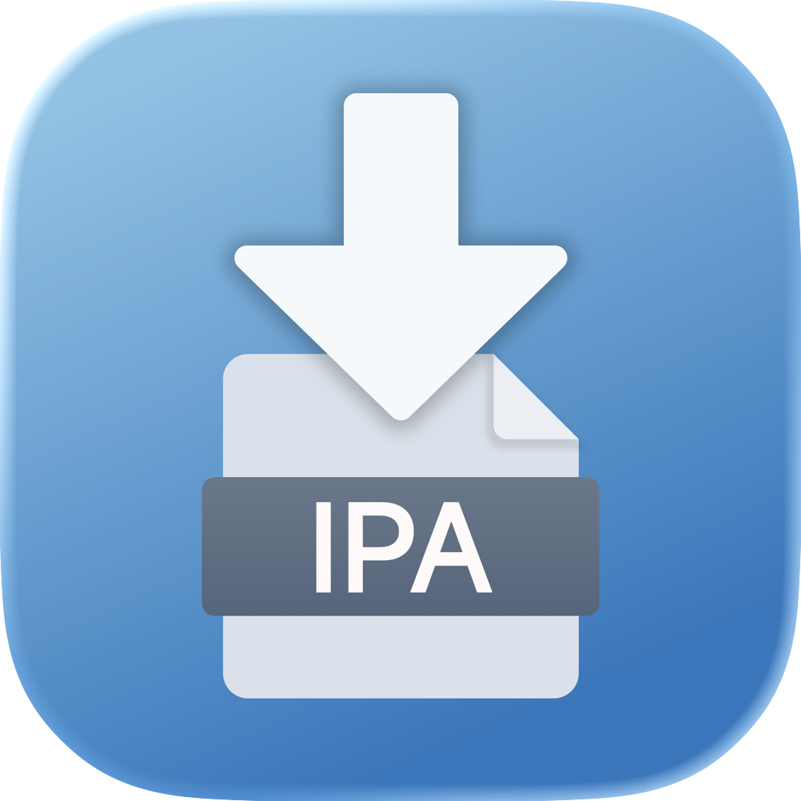
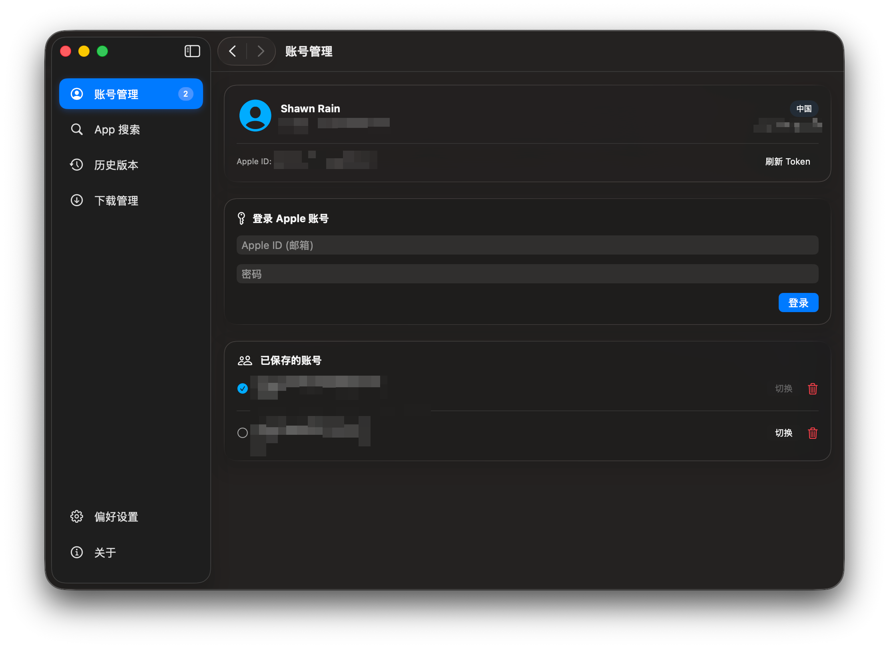
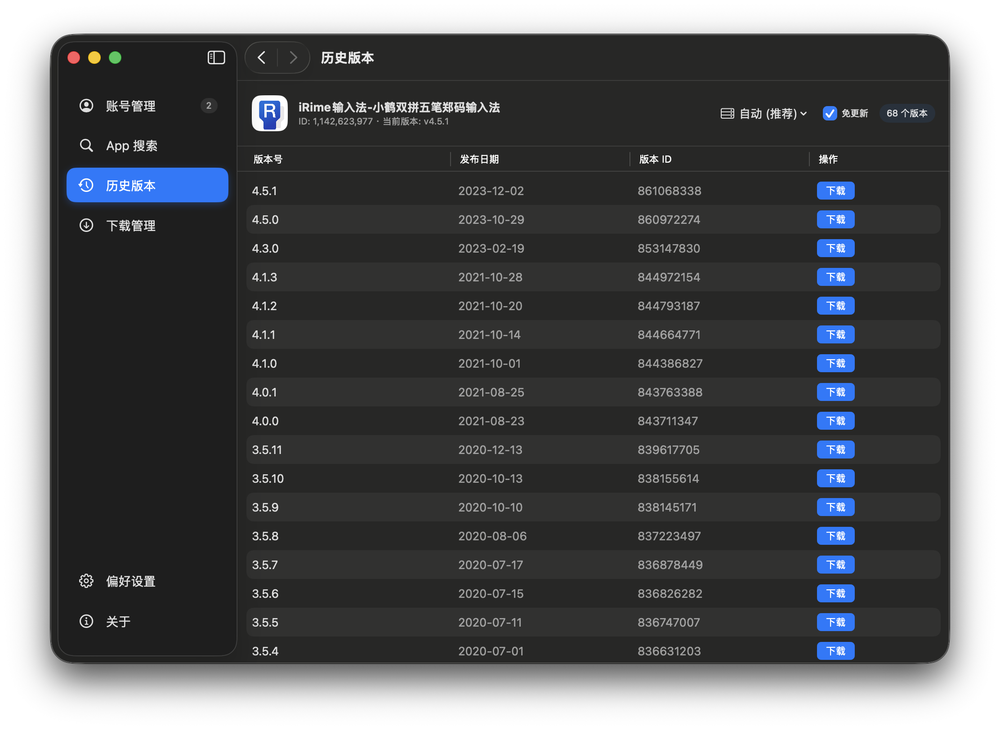

# ipaDown (Mac & iOS)

> This is a vibe-coded project.
> Developed with ❤️ using **Antigravity**.



**A lightweight Apple App Store download tool developed in Swift, supporting native macOS execution and iOS IPA export.**

[简体中文](./README_zh-CN.md) | [English](./README.md)

<br>


---

## 📸 Interface Preview

<p align="center">
  
  
</p>

---

## 📖 Introduction

**ipaDown** is a cross-platform download tool designed to fetch `.ipa` files directly from the App Store on macOS and iOS.

> 💡 **Inspiration**
> This project is inspired by the **ipaDown Windows version** released on the **52pojie forum**. Our mission is to migrate and enhance its core functionalities natively for the macOS ecosystem, providing a seamless experience for Apple users.

Powered by native system APIs, it offers a clean, native UI while ensuring high-performance downloads.

## ✨ Features

- **Native Experience**: Built with SwiftUI for a smooth, responsive macOS interface.
- **Account Management**: Support for multiple Apple IDs and quick switching between Storefront regions.
- **Advanced Search**: Search for apps and retrieve historical version IDs effortlessly.
- **High-Speed Download**: Native URLSession chunked downloads with concurrent transfers.
- **Auto-Refresh**: Automatic token refreshing to keep your sessions active.
- **Cross-Platform Support**: Download App Store IPA files on macOS and iOS/iPadOS; installation depends on decryption, signing and device compatibility.
- **Automated Build**: Integrated cross-platform build script to generate both macOS `.dmg` and iOS `.ipa` in one click.
- **Automatic Updates**: Integrated Sparkle framework (macOS only) to keep you on the latest version.

## Local IPA decryption (macOS)

Decrypt a completed download or select a local IPA. The first-run wizard recovers a private FairPlay model on a supported stable Apple silicon Mac. It requires signing in to the Mac App Store, installing and opening an iPhone/iPad app, and an IPA with matching enrollment state. Identical app version numbers are not required; UnfairPlay must validate the recovered model against the IPA.

Reuse the model for other IPAs personalized for the same enrollment, without installing each target app on the Mac. Models stay local, originals are preserved, and results are saved separately. Decryption does not re-sign an app or guarantee sideloading compatibility. Local decryption is not available on iOS. Use only with lawfully acquired apps and accounts/devices you control.

See the [usage and build notes](docs/IPA砸壳.md). macOS source builds additionally require Git, network access and Go 1.26+. The embedded engine is pinned to the upstream revision used for this integration.

## Credits

- [DrWhax/UnfairPlay](https://github.com/DrWhax/unfairplay): the core FairPlay model recovery and IPA decryption engine. Its MIT, Apache-2.0 and component license notices are retained; complete licenses and NOTICE are bundled with the macOS app.
- [missuo/unfairplay-bot](https://github.com/missuo/unfairplay-bot): inspiration for integrating this decryption workflow. ipaDown does not include its Telegram bot or server code.
- [majd/ipatool](https://github.com/majd/ipatool): reference for App Store protocols and response handling.

## 📦 Installation

### Download Binary
Download the latest `.dmg` installer from the [Releases](https://github.com/ShawnRn/ipaDown-for-Mac/releases) page.

### Build from Source

1. **Clone the repository**
   ```bash
   git clone https://github.com/ShawnRn/ipaDown-for-Mac.git
   cd ipaDown-for-Mac
   ```

2. **Open the project**
   Open `ipaDown-for-Apple.xcodeproj` in Xcode.

3. **One-Click Automated Build (Recommended)**
   Run the built-in script to generate both macOS and iOS binaries in the `build_output` directory:
   ```bash
   chmod +x ./scripts/build_all.sh
   ./scripts/build_all.sh
   ```

4. **Manual Build**
   - Open `ipaDown-for-Apple.xcodeproj` in Xcode.
   - Select the `ipaDown` scheme and hit `Cmd + R` to run.
   - To export an iOS package, switch the target device to `Any iOS Device` in Xcode and perform an Archive.

## 🛠 Tech Stack

- **UI**: SwiftUI (macOS 26.0+, iOS 26.0+)
- **Core**: Swift / Swift Concurrency
- **Network**: URLSession + ZIPFoundation
- **Update**: Sparkle
- **Reference**: Uses strictly typed, safe Swift concurrency models.

## 📝 License

This project is licensed under the [MIT License](LICENSE).

---

<p align="center">
  Made with ❤️ by Shawn Rain
</p>
